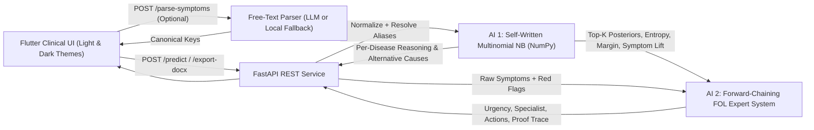

# VitalAI: Intelligent Disease Prediction & Clinical Triage System

VitalAI is a dual-AI medical decision-support application built for the **AI Lab Project**, demonstrating the meaningful integration of **Machine Learning (Self-Written Multinomial Naive Bayes)** and **Logic-Based Reasoning (Forward-Chaining First-Order Logic Expert System)** behind a **FastAPI** backend and a low-cognitive-load **Flutter** clinical interface.

> **Medical Disclaimer:** VitalAI is an academic clinical decision-support prototype. It does not provide medical advice and does not replace evaluation by a licensed physician.

---

## System Architecture



### How Everything Works Together

1. **Input Normalization, Clinical Alias Resolution & Free-Text Parsing (`backend/ml/symptom_aliases.py`, `symptom_parser.py`):**
   - Patient inputs (`["Chest Pain", "dyspnea", "diaphoresis"]`) are normalized and mapped via a conflict-free clinical synonym and US/UK spelling dictionary (`dyspnea` / `shortness of breath` $\rightarrow$ `breathlessness`, `diarrhea` $\rightarrow$ `diarrhoea`, `dysuria` $\rightarrow$ `burning_micturition`, `swollen extremities` $\rightarrow$ `swollen_extremeties`, etc.) onto the **131 canonical symptom features** without altering model weights, organized across **6 clinical body-system categories**.
   - **Bulk Free-Text / Optional AI Translator:** Clinicians can paste a quick list or clinical note; `parse_symptoms_smart` optionally calls **Gemini, Groq, or OpenAI** (strictly constrained to return only valid canonical keys from the 131 features) or falls back automatically to an offline negation-aware local synonym/fuzzy parser (`cutoff=0.87`).
2. **AI Component 1 — Self-Written Multinomial Naive Bayes (`backend/ml/naive_bayes.py`):**
   - Implemented from scratch in **NumPy** using log-priors $\log P(c_k)$, Laplace-smoothed likelihoods ($\alpha = 0.1$), and numerically stable **log-sum-exp** posterior calibration.
   - Outputs top-$K$ disease probabilities across **41 conditions**, normalized Shannon entropy, confidence margin, per-symptom log-likelihood contributions, discriminating follow-up symptoms, **matched supporting vs. unreported hallmark symptoms**, and **other possible diseases sharing the reported symptoms**.
3. **AI Component 2 — Forward-Chaining FOL Expert System (`backend/logic/expert_system.py`, `knowledge_base.py`):**
   - Asserts both raw symptoms (`HasSymptom(s)`, `SymptomCount(n)`) and ML outputs (`PredictedDisease(d, p)`, `CandidateDisease(d, p)`, `ConfidenceMargin(m)`) into a set-backed `WorkingMemory`.
   - Executes **14 First-Order Logic rules (`R1`–`R14`)** iteratively until a fixpoint:
     - **Red-Flag Overrides (`R2`–`R7`):** Escalates cardiac (`chest_pain` + `breathlessness`/`sweating`/`palpitations`), acute stroke, critical organ crisis, meningeal triad, hemoptysis, and severe dehydration to `Critical`/`High` urgency regardless of benign top-1 ML predictions.
     - **Uncertainty & Multi-Hop Differential Safety (`R8`–`R10`):** Flags ambiguous or single-symptom inputs and escalates urgency when a plausible runner-up candidate (`p >= 0.15`) carries higher clinical severity.
     - **Infection Control & Resolution (`R11`–`R14`):** Emits communicable precautions, resolves maximum urgency along `Low < Moderate < High < Critical`, and produces an auditable step-by-step **Inference Proof Trace**.
4. **FastAPI REST Backend & Word Consultation Sheet Export (`backend/api/app.py`, `schemas.py`, `docx_export.py`):**
   - Bridges the ML, parser, and Expert System engines over CORS-enabled JSON endpoints (`/health`, `/symptoms`, `/parse-symptoms`, `/predict`, `/export-docx`, `/metrics`), rejecting empty inputs (`HTTP 422`) and unrecognized symptom keys (`HTTP 400`).
   - `build_consultation_docx` generates a single-page **`.docx` consultation & prescription sheet** with a compact VitalAI triage summary at the top (~30% of the page) and open blank boxes (~70%) for handwritten investigations/lab tests, `Rx` medications, and clinical follow-up notes.
5. **Low-Cognitive-Load Flutter UI (`frontend/`):**
   - Light & Dark theme workspace with body-system category filter pills, search-driven symptom chips with keyboard shortcuts (`Enter`, `Ctrl+Enter`, `Esc`), 5 one-click clinical presets, collapsible `"Paste note / bulk list"` extractor, **Undo Clear** snackbar, in-session **Recent** consultation history strip, **Copy Note**, **Download Word (.docx)**, **Model Audit** evaluation modal, clickable follow-up chips, and collapsed-by-default panels for `Other Possible Causes` and `Rule Logic & Symptom Weights`.

---

## Dataset Engineering & Anti-Overfitting Verification

Trained on Kaggle's **"Disease Prediction Using Machine Learning"** (`data/Training.csv` and `data/Testing.csv`):
- **Schema Cleaning (`backend/ml/data_loader.py`):** Automatically strips empty `Unnamed:*` trailing columns, normalizes disease/symptom whitespace, and merges the raw CSV's all-zero `fluid_overload` column with `fluid_overload.1` (which held all 114 positive `Alcoholic hepatitis` rows) via logical OR — yielding **131 clean active symptom features** across **41 balanced diseases** (`4,920` training rows, `120`/class).
- **Duplicate-Leakage Audit:** `4,616 / 4,920` training rows (`93.82%`) are exact duplicates leaving **304 unique symptom patterns** (`5–10`/disease), and **all `41 / 41` `Testing.csv` vectors appear verbatim in `Training.csv`**. To test true generalization rather than memorization, `evaluate_model.py` runs **Deduplicated Stratified 5-Fold Cross-Validation** on the 304 unique patterns plus **Symptom-Dropout & Random Noise Stress Tests**.

| Model | Train Acc (`4,920`) | Official Test (`41`) | Deduplicated 5-Fold CV (`304` unique) | Gen. Gap | Out-of-Fold Noisy CV (`20%` drop + `2%` noise) | Perturbed Test (`20%` drop + `1%` noise) |
| :--- | :---: | :---: | :---: | :---: | :---: | :---: |
| **`MultinomialNB (alpha=0.1)` (Saved)** | `100.00%` | `100.00%` | **`100.00%`** (`log_loss=0.0121`) | `0.0000` | **`97.08%`** | `98.05%` |
| `BernoulliNB (alpha=0.25)` | `100.00%` | `100.00%` | `100.00%` (`log_loss=0.0013`) | `0.0000` | `96.76%` | `98.54%` |
| `CosineKNN (k=5)` | `99.88%` | `100.00%` | `100.00%` (`log_loss=0.0208`) | `-0.0025` | `96.39%` | `98.54%` |

*(Evaluation plots and metrics are stored in `backend/artifacts/alpha_tuning_curve.png`, `confusion_matrix.png`, `model_comparison.png`, `evaluation_report.json`, and `training_summary.json`.)*

---

## Project Structure

```text
VitalAI/
├── backend/
│   ├── ml/
│   │   ├── data_loader.py         # CSV cleaning, column merge, deduplication, stratified K-fold
│   │   ├── symptom_aliases.py     # Clinical synonym, US/UK spelling, body-system groups & alias map
│   │   ├── symptom_parser.py      # Free-text / optional LLM translator + local negation fallback
│   │   ├── naive_bayes.py         # Self-written NumPy Multinomial & Bernoulli Naive Bayes
│   │   ├── knn_baseline.py        # Self-written NumPy Cosine-Similarity KNN baseline
│   │   ├── evaluate_model.py      # Alpha sweep, deduplicated CV, dropout stress tests, plots
│   │   └── train_model.py         # CLI model training + overfitting audit gate
│   ├── logic/
│   │   ├── knowledge_base.py      # 41-disease clinical ontology & severity lattice
│   │   └── expert_system.py       # 14-rule Forward-Chaining FOL inference engine
│   ├── api/
│   │   ├── schemas.py             # Pydantic v2 validation & alias-resolving schemas
│   │   ├── docx_export.py         # Pure-Python single-page OpenXML (.docx) note generator
│   │   ├── app.py                 # FastAPI service (/health, /symptoms, /parse-symptoms, /predict, /export-docx, /metrics)
│   │   └── healthcheck.py         # TCP port & /health readiness helper for launcher
│   └── artifacts/                 # Saved nb_model.npz, metadata, metrics & evaluation plots
├── frontend/                      # Lightweight Flutter UI (Web, Windows, Android)
│   ├── lib/
│   │   ├── main.dart
│   │   ├── models/triage_models.dart
│   │   ├── services/
│   │   │   ├── vital_api_client.dart
│   │   │   ├── file_saver.dart
│   │   │   ├── file_saver_io.dart
│   │   │   └── file_saver_web.dart
│   │   ├── widgets/symptom_selector.dart
│   │   ├── widgets/triage_result_panel.dart
│   │   └── screens/triage_screen.dart
│   └── test/widget_test.dart
├── data/                          # Kaggle Training.csv, Testing.csv & schema README
├── tests/                         # Pytest unit, parser, rule-validation & FastAPI integration suite
├── docs/
│   ├── Lab_Report.md              # Complete 12-section AI Lab Project Report
│   └── Viva_Guide.md              # Exam & viva preparation guide
├── .env.example                   # Optional GEMINI_API_KEY / GROQ_API_KEY / OPENAI_API_KEY template
├── run_vitalai.bat                # One-click Windows launcher (Backend + Flutter UI)
├── requirements.txt
└── pytest.ini
```

---

## Quick Start

### Option 1: One-Click Windows Launcher
Double-click `run_vitalai.bat` or run from terminal:
```bat
run_vitalai.bat chrome
```
Supports `chrome` (Web), `windows` (Desktop), `default` (Connected Device/Emulator), or `api` (Backend Swagger Docs only).

### Option 2: Manual Setup

#### 1. Python Backend & ML Training
```powershell
pip install -r requirements.txt

# Optional: enable AI free-text symptom translation (works offline without this)
copy .env.example .env
# Then add ONE of GEMINI_API_KEY, GROQ_API_KEY, or OPENAI_API_KEY inside .env

# Optional: re-run training & anti-overfitting evaluation
python -m backend.ml.train_model --data-dir data --model-type multinomial --alpha 0.1

# Start FastAPI server (http://127.0.0.1:8000/docs)
python -m uvicorn backend.api.app:app --host 127.0.0.1 --port 8000
```

#### 2. Flutter Frontend
```powershell
cd frontend
flutter pub get
flutter run -d chrome
```
*(When running on an Android Emulator, open the top-right gear icon in the app and set the API URL to `http://10.0.2.2:8000`. You can also toggle Light/Dark themes and optionally enter a session-only Gemini, Groq, or OpenAI key in Settings.)*

---

## API Reference

- `GET /health` — Server status, loaded model type, feature count (`131`), disease count (`41`), and `llm_translator_configured` / `llm_provider`.
- `GET /symptoms?q=dyspnea` — Canonical symptom list with display names, body-system `category`, and searchable clinical aliases.
- `POST /parse-symptoms` — Accepts `{"text": "patient c/o SOB, diaphoresis, no fever"}` (with optional `provider` / `api_key`) and maps free-text clinical notes onto canonical symptom keys, returning `matched_symptoms`, `unmapped_terms`, `negated_terms`, and parser `mode` (`llm:*` or `local_fallback`).
- `POST /predict` — Accepts `{"symptoms": ["Chest Pain", "dyspnea", "sweating"], "top_k": 3}` and returns top candidates with reasoning summaries, alternative causes, per-symptom causes, follow-up differentiating symptoms, Expert System triage outcome, and rule inference trace.
- `POST /export-docx` — Accepts the same symptom payload plus optional `patient_name` and streams a single-page `.docx` consultation & prescription worksheet (`vitalai_consultation_note.docx`) ready for handwritten investigations, `Rx`, and follow-up notes.
- `GET /metrics?compact=true` — Returns dataset diagnostics and 3-model evaluation comparison.

---

## Running Tests

```powershell
# Backend ML, parser, Expert System rule validation & FastAPI tests (28 tests)
python -m pytest -v tests/

# Flutter static analysis & widget tests (4 tests)
cd frontend
flutter analyze
flutter test
```

---

## Academic Deliverables & Team Division

- Full 12-section report: [`docs/Lab_Report.md`](docs/Lab_Report.md)
- Viva & exam study sheet: [`docs/Viva_Guide.md`](docs/Viva_Guide.md)
- **Member 1 (Abdul Hadi — AI/ML Lead):** Data cleaning, self-written Naive Bayes & KNN comparison, deduplicated CV & dropout evaluation.
- **Member 2 (Logic & Triage Engineer):** 41-disease clinical KB, Forward-Chaining FOL rules, rule validation tests.
- **Member 3 (Backend & API Integration):** FastAPI endpoints, clinical alias mapping, error handling & reasoning aggregation.
- **Member 4 (Frontend UI & Documentation):** Low-cognitive-load Flutter UI, widget tests, ethical analysis & report compilation.
