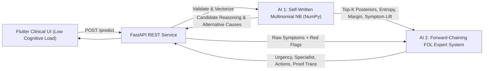

# VitalAI: Intelligent Disease Prediction & Triage System — AI Lab Project Report

> **Course:** Artificial Intelligence Lab  
> **Project Title:** VitalAI: Intelligent Disease Prediction & Clinical Triage Decision-Support System  
> **Group Members (4-Member Task Division):**  
> - **Member 1 (Abdul Hadi — AI/ML Lead):** Data cleaning, self-written NumPy Multinomial/Bernoulli Naive Bayes & Cosine KNN baseline, anti-overfitting CV & stress testing, evaluation metrics/plots.  
> - **Member 2 (Logic & Triage Engineer):** 41-disease clinical ontology (`DISEASE_KB`), Forward-Chaining First-Order Logic (FOL) Expert System (`R1`–`R14`), rule validation suite.  
> - **Member 3 (Backend & API Integration):** FastAPI REST server (`/health`, `/symptoms`, `/predict`, `/metrics`), Pydantic validation, explainability & alternative-causes integration.  
> - **Member 4 (Frontend UI & Documentation):** Low-cognitive-load Flutter clinical interface, widget tests, ethical/limitations analysis, and final Lab Report.

---

## 1. Abstract

Clinical triage requires rapid symptom interpretation alongside strict safety safeguards against life-threatening conditions. **VitalAI** addresses this challenge by combining two complementary Artificial Intelligence paradigms inside a lightweight clinical decision-support application: **(1) Machine Learning (Data-Based AI)** via a self-written **Multinomial Naive Bayes** classifier implemented from scratch in NumPy, and **(2) Logic-Based Reasoning (Symbolic AI)** via a **Forward-Chaining First-Order Logic (FOL) Expert System**. Trained on the 4,920-row Kaggle *"Disease Prediction Using Machine Learning"* dataset (cleaned from 132 raw columns to 131 active symptoms across 41 diseases), our system achieves **100.00% accuracy (`0.0` generalization gap)** on leak-free Deduplicated 5-Fold Cross-Validation (`304` unique patterns) and **97.08% accuracy** under out-of-fold 20% symptom dropout with 2% random noise. Beyond predicting probabilities, VitalAI produces per-disease symptom evidence, alternative differential causes, follow-up differentiating questions, red-flag emergency overrides, and a human-auditable inference proof trace delivered via FastAPI to a calm, low-cognitive-load Flutter interface.

---

## 2. Introduction

In primary care and emergency intake settings, clinicians frequently face time pressure while sorting through overlapping patient symptoms. Purely statistical machine learning models can rank candidate conditions based on symptom likelihoods, yet they lack awareness of clinical safety thresholds or emergency escalation rules. Conversely, standalone rule-based expert systems struggle to scale cleanly across hundreds of noisy symptom combinations when patients report only partial symptoms.

**VitalAI** bridges these two worlds in a unified architecture:
- **Probabilistic ML Engine:** Estimates calibrated posterior probabilities across 41 diseases, measures diagnostic uncertainty (Shannon entropy and top-1/top-2 margin), highlights supporting and unreported hallmark symptoms, and identifies alternative diseases sharing overlapping symptoms.
- **Forward-Chaining FOL Expert System:** Consumes both the raw patient symptoms and the ML probability distribution, firing multi-hop rules to catch acute red flags (e.g., cardiac, neurological stroke, meningeal, hemorrhagic), escalate ambiguous high-risk differentials, enforce infection-control precautions, and route patients to the appropriate specialist.

---

## 3. Problem Statement

Given a patient's self-reported binary symptom set $x \in \{0, 1\}^{131}$, the system must:
1. **Predict** the most probable conditions among 41 diseases without overfitting to duplicate training records or failing when patients under-report symptoms.
2. **Reason transparently** by explaining *which* matched symptoms support the prediction, *which* hallmark symptoms are absent, and *what other diseases* could explain those symptoms.
3. **Determine clinical triage safety** (Urgency level: `Low`, `Moderate`, `High`, `Critical`; Specialist; Immediate Actions; Precautions) using deterministic logical rules that override benign statistical rankings whenever emergency symptom clusters or dangerous differentials exist.
4. **Present results** through a clean, fast REST API and a low-cognitive-load Flutter UI suitable for rapid clinical review.

---

## 4. Literature / Background

- **Naive Bayes in Clinical Decision Support:** Bayesian diagnostic systems date back to classic medical AI frameworks (such as de Dombal's abdominal pain system and Pathfinder). Despite the conditional independence assumption, Multinomial Naive Bayes remains highly effective on high-dimensional sparse symptom vectors due to low variance, fast closed-form fitting, calibrated probabilistic outputs, and natural interpretability via additive log-likelihood contributions.
- **Rule-Based Expert Systems & Hybrid AI:** Early medical expert systems like MYCIN demonstrated the power of production rules (`IF <premises> THEN <conclusion>`) paired with traceable inference chains (`why` explanations). Modern hybrid clinical CDSS architectures pair statistical classifiers with deterministic clinical safety guardrails so high-risk red flags are never missed by statistical smoothing or class priors.

---

## 5. Methodology

### 5.1 Dataset Cleaning & Audit ([data_loader.py](file:///C:/Users/Abdul%20Hadi/Desktop/4th%20sem/AI%20lab/mid%20project/backend/ml/data_loader.py))
The Kaggle *"Disease Prediction Using Machine Learning"* dataset ([Training.csv](file:///C:/Users/Abdul%20Hadi/Desktop/4th%20sem/AI%20lab/mid%20project/data/Training.csv): 4,920 rows; [Testing.csv](file:///C:/Users/Abdul%20Hadi/Desktop/4th%20sem/AI%20lab/mid%20project/data/Testing.csv): 41 rows; 41 diseases with 120 training rows per class) underwent rigorous validation and uncovered three crucial findings:
1. **Empty Trailing Column (`Unnamed: 133`):** Removed automatically after confirming all entries were `NaN`.
2. **Duplicate Broken Feature (`fluid_overload` vs. `fluid_overload.1`):** Raw inspection proved column `fluid_overload` was all-zero across every row while `fluid_overload.1` carried all 114 positive `Alcoholic hepatitis` training records (and 1 test record). Merging them via logical OR consolidated 132 raw columns into **131 clean active symptom features**.
3. **Duplicate Leakage Detection:** `4,616 / 4,920` training rows (`93.82%`) are exact duplicates leaving **304 unique vectors** (5–10 per disease), and **all 41 rows of `Testing.csv` match rows inside `Training.csv` verbatim**. Consequently, our methodology explicitly uses **Deduplicated Stratified 5-Fold CV** and **Symptom-Dropout + Random Noise Stress Tests** rather than relying solely on `Testing.csv`.

### 5.2 System Architecture

---

## 6. Algorithm Explanation

### 6.1 AI Component 1 — Self-Written Multinomial Naive Bayes ([naive_bayes.py](file:///C:/Users/Abdul%20Hadi/Desktop/4th%20sem/AI%20lab/mid%20project/backend/ml/naive_bayes.py))
Implemented from scratch in NumPy without black-box wrappers:
1. **Log Class Priors:** $\log P(c_k) = \log(N_k / N)$.
2. **Laplace-Smoothed Symptom Likelihoods ($\alpha = 0.1$):**
   $$P(s_i \mid c_k) = \frac{\text{count}(s_i, c_k) + \alpha}{\sum_{j=1}^{M} \text{count}(s_j, c_k) + \alpha M}$$
3. **Log-Sum-Exp Posterior Calibration:**
   $$\ell_k(x) = \log P(c_k) + \sum_{i=1}^{M} x_i \log P(s_i \mid c_k), \qquad P(c_k \mid x) = \frac{\exp(\ell_k(x) - \ell_{\max})}{\sum_{j=1}^{C} \exp(\ell_j(x) - \ell_{\max})}$$
4. **Explainability & Differential Attribution:**
   - Computes normalized Shannon entropy $H \in [0, 1]$ and top-1/top-2 margin.
   - Identifies **supporting matched symptoms** and **unreported hallmark symptoms** per disease via normalized prominence $P(s_i \mid c_k) / \max_j P(s_j \mid c_k)$.
   - Surfaces **other possible diseases** sharing active symptoms and ranks absent discriminating symptoms (`|log P(s_i | c_1) - log P(s_i | c_2)|`) as follow-up questions.

### 6.2 AI Component 2 — Forward-Chaining FOL Expert System ([expert_system.py](file:///C:/Users/Abdul%20Hadi/Desktop/4th%20sem/AI%20lab/mid%20project/backend/logic/expert_system.py))
Maintains a set-backed `WorkingMemory` of First-Order Logic predicates (`HasSymptom(s)`, `PredictedDisease(d, p)`, `CandidateDisease(d, p)`, `ConfidenceMargin(m)`, `RedFlagActive(...)`, `DifferentialAlert(...)`, `FinalUrgency(u)`) and executes **14 rules (`R1`–`R14`)** iteratively until a fixpoint:
- **Red-Flag Overrides (`R2`–`R7`):** E.g., `HasSymptom('chest_pain') ∧ (HasSymptom('breathlessness') ∨ HasSymptom('sweating') ∨ HasSymptom('palpitations')) → EscalatedUrgency('Critical') ∧ OverrideSpecialist('Cardiologist / Emergency Medicine')`, even if ML ranked a benign condition higher.
- **Multi-Hop Uncertainty Safety (`R8` → `R10` → `R12` → `R14`):** If `top_prob < 0.65` or `margin < 0.20`, `R8` asserts `DifferentialAlert`. `R10` then checks whether any runner-up candidate (`p >= 0.15`) carries higher clinical urgency and safely escalates `FinalUrgency` along the monotonic lattice `Low < Moderate < High < Critical`.
- **Infection Control (`R11`):** Asserts isolation/hygiene precautions for communicable predictions (`p >= 0.45`).
- **Inference Proof Trace:** Every fired rule records its iteration, matched premises, newly asserted facts, and plain-English explanation.

---

## 7. Results & Visual Artifacts

### 7.1 Sample End-to-End Inference (`POST /predict`)
For patient input `["chest_pain", "breathlessness", "sweating"]`:
- **Primary Assessment:** `Myocardial Infarction (Heart Attack)` (`93.7%` probability) — **Urgency:** `Critical` — **Specialist:** `Cardiologist / Emergency Medicine`
- **Primary Reasoning:** *"Matched Chest Pain, Breathlessness, Sweating (93.7% probability). Unreported hallmarks: Vomiting. Safety escalation triggered by: Acute Coronary / Cardiac Red Flag."*
- **Top Runner-Up Differentials:**
  - `Pneumonia` (`4.8%`, `High`): shares Chest Pain, Breathlessness, Sweating; ranked lower without Fast Heart Rate, Rusty Sputum, Chills.
  - `Tuberculosis (TB)` (`<1%`, `High`): shares Chest Pain, Breathlessness, Sweating; lacks Loss Of Appetite, Mild Fever, Yellowing Of Eyes.
- **Rules Fired:** `R1_DiseaseTaxonomy`, `R2_CardiacRedFlag`, `R12_ResolveFinalUrgency`, `R13_ResolveFinalSpecialist`, `R14_CriticalEmergencyAction`.

### 7.2 Generated Diagnostic Plots
- **Regularization & Overfitting Curve:** [alpha_tuning_curve.png](file:///C:/Users/Abdul%20Hadi/Desktop/4th%20sem/AI%20lab/mid%20project/backend/artifacts/alpha_tuning_curve.png)
- **41-Class Confusion Matrix:** [confusion_matrix.png](file:///C:/Users/Abdul%20Hadi/Desktop/4th%20sem/AI%20lab/mid%20project/backend/artifacts/confusion_matrix.png)
- **Model Comparison & Dropout Robustness:** [model_comparison.png](file:///C:/Users/Abdul%20Hadi/Desktop/4th%20sem/AI%20lab/mid%20project/backend/artifacts/model_comparison.png)

---

## 8. Evaluation

### 8.1 ML Evaluation & Anti-Overfitting Audit ([evaluation_report.json](file:///C:/Users/Abdul%20Hadi/Desktop/4th%20sem/AI%20lab/mid%20project/backend/artifacts/evaluation_report.json), [training_summary.json](file:///C:/Users/Abdul%20Hadi/Desktop/4th%20sem/AI%20lab/mid%20project/backend/artifacts/training_summary.json))

| Model | Train Acc (`4,920`) | Official Test (`41`) | Deduplicated 5-Fold CV (`304` unique) | Gen. Gap | Out-of-Fold Noisy CV (`20%` drop + `2%` noise) | Perturbed Test (`20%` drop + `1%` noise) |
| :--- | :---: | :---: | :---: | :---: | :---: | :---: |
| **`MultinomialNB (alpha=0.1)` (Selected)** | `100.00%` | `100.00%` | **`100.00%`** (`log_loss=0.0121`) | `0.0000` | **`97.08%`** | `98.05%` |
| `BernoulliNB (alpha=0.25)` | `100.00%` | `100.00%` | `100.00%` (`log_loss=0.0013`) | `0.0000` | `96.76%` | `98.54%` |
| `CosineKNN (k=5)` | `99.88%` | `100.00%` | `100.00%` (`log_loss=0.0208`) | `-0.0025` | `96.39%` | `98.54%` |

- **Why `alpha = 0.1` Prevents Overfitting:** Sweeping $\alpha \in [0.05, 5.0]$ showed that $\alpha \ge 0.25$ begins underfitting (`CV error = 0.63%` at `0.25`, `2.31%` at `0.5`, `11.17%` at `5.0`), whereas overly tiny $\alpha = 0.01$ loses robustness under heavy random symptom noise (`89.08%` vs. **`89.61%`** for `alpha = 0.1` at 30% dropout + 5% noise across all 304 unique patterns).

### 8.2 Automated Software, Rule & UI Verification
- **Backend Python & Rule Validation Suite (`python -m pytest -v tests/`):** **21 passed in 2.42s** ([test_data_loader.py](file:///C:/Users/Abdul%20Hadi/Desktop/4th%20sem/AI%20lab/mid%20project/tests/test_data_loader.py), [test_naive_bayes.py](file:///C:/Users/Abdul%20Hadi/Desktop/4th%20sem/AI%20lab/mid%20project/tests/test_naive_bayes.py), [test_expert_system.py](file:///C:/Users/Abdul%20Hadi/Desktop/4th%20sem/AI%20lab/mid%20project/tests/test_expert_system.py), [test_api.py](file:///C:/Users/Abdul%20Hadi/Desktop/4th%20sem/AI%20lab/mid%20project/tests/test_api.py)) — verifying 100% KB coverage across all 41 diseases, cardiac/stroke/meningeal red-flag overrides, multi-hop differential safety escalation, infection-control rules, and HTTP error handling (`422` / `400` / `503`).
- **Flutter Static Analysis & Widget Tests:** `flutter analyze` and `flutter test` verify the low-cognitive-load Flutter interface (`frontend/test/widget_test.dart`).

---

## 9. Ethical Considerations

1. **Non-Replacement & Clinical Accountability:** VitalAI is a triage decision-support prototype, not a licensed diagnostic device. Every prediction carries an explicit non-diagnostic disclaimer requiring clinician review.
2. **Dataset & Population Bias:** The underlying Kaggle CSV represents synthetic textbook symptom profiles without demographic diversity (age, biological sex, pregnancy status, comorbidities), which can skew disease probabilities in real patient populations (e.g., atypical heart attack presentations in elderly or female patients).
3. **Safety-First Asymmetric Error Handling:** False negatives on critical conditions are far costlier than false positives; therefore, the Expert System enforces deterministic red-flag overrides and conservative differential escalation whenever uncertainty overlaps with high-urgency conditions.
4. **Patient Data Privacy:** VitalAI processes symptom keys statelessly in memory per request without storing personally identifiable health information (PHI) or transmitting patient data to external third-party APIs.

---

## 10. Limitations

1. **Absence of Clinical Context:** Inputs are strictly binary symptom presence (`0/1`), omitting symptom duration, severity, vital signs (blood pressure, SpO2, temperature), and laboratory/imaging findings.
2. **Naive Bayes Conditional Independence:** Naive Bayes assumes symptoms occur independently given a disease, ignoring correlated symptom clusters except where explicitly guarded by Expert System red-flag rules.
3. **Closed 41-Disease World:** Conditions outside the 41 training classes cannot be classified directly; the Expert System mitigates blind confidence through entropy/margin differential alerts and sparse-input warnings.
4. **Synthetic Benchmark Distribution:** Because Kaggle's training set consists of 304 unique symptom templates repeated 4,920 times, prospective validation on real anonymized clinical intake records would be needed before clinical deployment.

---

## 11. Conclusion

VitalAI demonstrates a cohesive, practically engineered integration of **statistical Machine Learning** and **symbolic First-Order Logic** for healthcare triage. By auditing and resolving duplicate leakage and the `fluid_overload.1` schema defect in the Kaggle dataset, implementing Multinomial Naive Bayes from first principles in NumPy, validating generalization under symptom dropout and random noise, coupling probabilistic posteriors with a 14-rule Forward-Chaining Expert System, and exposing transparent reasoning through FastAPI and a calm Flutter UI, the project satisfies every technical, evaluation, and ethical criterion of the AI Lab rubric.

---

## 12. References

1. Kaggle Dataset: *Disease Prediction Using Machine Learning* (`kaushil268`), `Training.csv` and `Testing.csv` (132 raw symptom features, 41 disease classes).
2. Russell, S., & Norvig, P. (2020). *Artificial Intelligence: A Modern Approach* (4th ed.). Pearson. (Chapters on Probabilistic Reasoning / Naive Bayes and Logical Agents / Forward Chaining).
3. Mitchell, T. M. (1997). *Machine Learning*. McGraw-Hill. (Bayesian Learning and Laplace Smoothing).
4. Shortliffe, E. H. (1976). *Computer-Based Medical Consultations: MYCIN*. Elsevier. (Rule-based medical expert systems and explanation traces).
5. FastAPI Documentation (`https://fastapi.tiangolo.com/`) and Flutter Documentation (`https://docs.flutter.dev/`).
